  

# Echo

Echo is an Android [Matrix](https://matrix.org/) client built with [Jetpack Compose](https://developer.android.com/jetpack/compose), [Appyx](https://github.com/bumble-tech/appyx), and the [Matrix Rust SDK](https://github.com/matrix-org/matrix-rust-sdk), targeting Android 7+.

## Table of contents

<!--- TOC -->

* [Branding](#branding)
* [Translations](#translations)
* [Rust SDK](#rust-sdk)
* [Status](#status)
* [Minimum SDK version](#minimum-sdk-version)
* [Contributing](#contributing)
* [Build instructions](#build-instructions)
* [Support](#support)
* [Copyright and License](#copyright-and-license)

<!--- END -->

## Branding

Echo branding assets are available in [`public/`](./public/):

| | |
|---|---|
|  |  |
|  |  |

## Translations

Echo is based on a codebase that supports many languages via [Localazy](https://localazy.com/p/element). See [CONTRIBUTING.md](CONTRIBUTING.md#strings) for details on strings and translations.

## Rust SDK

Echo uses the [Matrix Rust SDK](https://github.com/matrix-org/matrix-rust-sdk) through an FFI layer.

## Status

This project is under active development.

## Minimum SDK version

Echo requires a minimum SDK version of 24 (Android 7.0, Nougat).

## Contributing

Contributions are welcome. Please read the [contribution guide](CONTRIBUTING.md) before opening a pull request.

## Build instructions

Clone the project and open it in Android Studio. Select the `app` configuration when building (the project also includes sample apps).

To build against a local copy of the Rust SDK, see the [Developer onboarding](docs/_developer_onboarding.md#building-the-sdk-locally) instructions.

## Support

For bugs or crashes, please open an issue in this repository with clear reproduction details. You can also report issues from the application settings when available.

## Copyright and License

Copyright (c) 2025 Element Creations Ltd.
Copyright (c) 2022 - 2025 New Vector Ltd.

This software is dual licensed by Element Creations Ltd (Element). It can be used either:

(1) for free under the terms of the GNU Affero General Public License (as published by the Free Software Foundation, either version 3 of the License, or (at your option) any later version); OR

(2) under the terms of a paid-for Element Commercial License agreement between you and Element (the terms of which may vary depending on what you and Element have agreed to).

Unless required by applicable law or agreed to in writing, software distributed under the Licenses is distributed on an "AS IS" BASIS, WITHOUT WARRANTIES OR CONDITIONS OF ANY KIND, either express or implied. See the Licenses for the specific language governing permissions and limitations under the Licenses.

